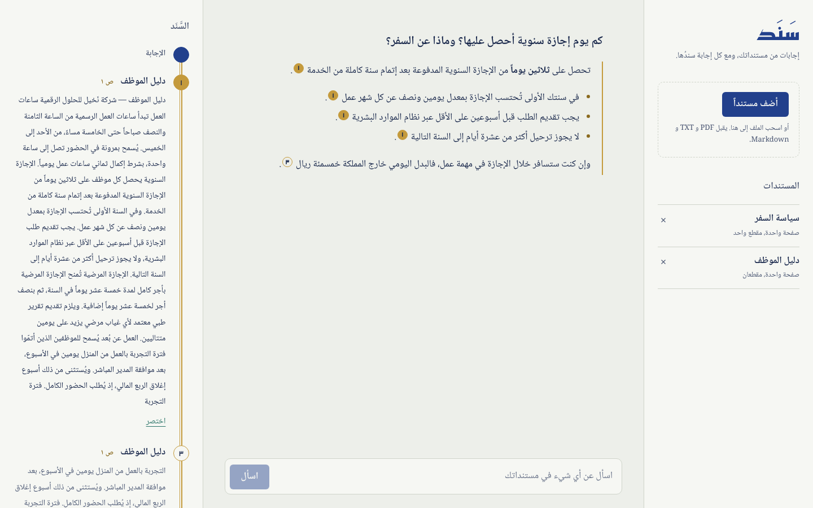

<div dir="rtl">

# سَنَد

**اسأل مستنداتك، واحصل على إجابة مسنودة بمصادرها.**

ارفع ملفات PDF أو نصوصاً، واطرح أسئلتك بالعربية أو الإنجليزية. يبحث سَنَد في مستنداتك عن المقاطع ذات الصلة، ويكتب Claude الإجابة منها فقط. وبجانب كل إجابة يظهر **سَنَدها**: سلسلة المقاطع والصفحات التي استندت إليها، فتتحقق بنفسك.



## المزايا

- إجابات من مستنداتك وحدها، ومع كل جملة رقم المقطع الذي جاءت منه.
- لوحة "السَّنَد": خيط يربط الإجابة بمصادرها، واضغط أي رقم لتقرأ المقطع كاملاً.
- بحث دلالي متعدد اللغات (عربي وإنجليزي) يعمل محلياً دون تكلفة إضافية.
- كتابة الإجابة مباشرة أثناء توليدها (streaming).
- وضع ليلي تلقائي، وتصميم يعمل على الجوال.

## التقنيات

| الطبقة | التقنية |
|---|---|
| الواجهة | React 18 + TypeScript + Vite |
| الخادم | Python + FastAPI |
| قاعدة البيانات | PostgreSQL 16 + pgvector |
| الذكاء الاصطناعي | Claude API (`claude-opus-5-5`) |
| التضمين (Embeddings) | fastembed: `paraphrase-multilingual-MiniLM-L12-v2` |

## التشغيل السريع (Docker)

```bash
cp .env.example .env        # ثم ضع مفتاحك في ANTHROPIC_API_KEY
docker compose up --build
```

افتح http://localhost:8080 وارفع ملفاً من مجلد `samples/` للتجربة.

## التشغيل للتطوير

**المتطلبات:** Python 3.12+ و Node 20+ و PostgreSQL 16 مع إضافة pgvector.

```bash
# قاعدة البيانات (أسهل طريقة)
docker run -d --name sanad-db -p 5432:5432 \
  -e POSTGRES_USER=sanad -e POSTGRES_PASSWORD=sanad -e POSTGRES_DB=sanad \
  pgvector/pgvector:pg16

# الخادم
cd backend
python -m venv .venv && source .venv/bin/activate
pip install -r requirements-dev.txt
cp ../.env.example .env      # وضع المفتاح
uvicorn app.main:app --reload

# الواجهة (في نافذة أخرى)
cd frontend
npm install
npm run dev                  # http://localhost:5173
```

## الاختبارات

```bash
createdb -U sanad sanad_test   # مرة واحدة
cd backend && pytest -q
```

## بنية المشروع

```
backend/app/
  main.py         نقطة تشغيل FastAPI
  ingest.py       استخراج النص من الملفات وتقطيعه
  embeddings.py   تحويل النص إلى متجهات
  retrieval.py    البحث بالتشابه عبر pgvector
  llm.py          توليد الإجابة من Claude مع الاستشهادات
  routes/         واجهات API: المستندات والمحادثة
frontend/src/
  components/     المكتبة، والمحادثة، ولوحة السند
  api.ts          الاتصال بالخادم وقراءة البث
```

## واجهات API

| الطريقة | المسار | الوصف |
|---|---|---|
| `GET` | `/api/documents` | قائمة المستندات |
| `POST` | `/api/documents` | رفع ملف (`multipart/form-data`) |
| `DELETE` | `/api/documents/{id}` | حذف مستند |
| `POST` | `/api/chat` | سؤال، والرد بثّ أحداث: `sources` ثم `delta` ثم `done` |

</div>

---

## Sanad (English)

**Ask your documents. Every answer comes with its chain of sources.**

Sanad is a retrieval-augmented Q&A app: upload PDFs or text, ask in Arabic or English, and Claude answers only from the retrieved passages, citing each claim. The *sanad* panel (named after the classical chain of transmission) links every answer to the exact passages and pages it relied on.

**Stack:** React + TypeScript (Vite) · FastAPI · PostgreSQL + pgvector · Claude API · fastembed multilingual embeddings.

```bash
cp .env.example .env   # add ANTHROPIC_API_KEY
docker compose up --build   # → http://localhost:8080
```

MIT licensed.
